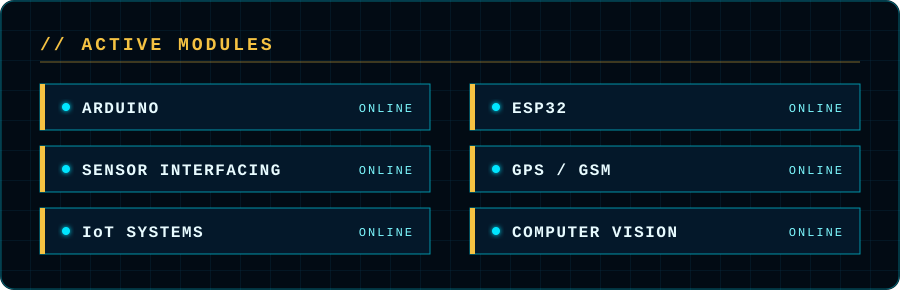

<div align="center">






<br/>


</div>

---

## 🧠 `JARVIS> whoami`

```text
> NAME        : Rahul S D
> STATUS      : Final-year ECE student
> FOCUS       : IoT-based embedded systems
> ACTIVE OPS  : FuelGuard+ | Smart Traffic Signal | Cable Fault Detector
> DIRECTIVE   : Hardware x Software x Innovation
```

---

<div align="center">
  
</div>

---

## ⚙️ `PROJECT FILES`

| Project | Mission | Stack |
|---|---|---|
| ⛽ **FuelGuard+** | Low-cost fuel fraud and theft detection for commercial fleets | ESP32, Sensors, GPS, GSM |
| 🚦 **Smart Traffic Signal** | Adapts signal timing from camera input | Computer Vision, IoT |
| 🔌 **Underground Cable Fault Detection** | Locates faults in underground cables | Embedded Systems |
| 📡 **Sensor Interfacing** | Drivers and test code for common sensors | Arduino, ESP32 |

---

## 🧊 `3D CONTRIBUTION MATRIX`

<div align="center">
  
</div>

---

## 📊 `TELEMETRY`

<div align="center">


</div>

---

## 📡 `OPEN CHANNEL`

<div align="center">

[](https://www.linkedin.com/in/rahul-sd-4aa951326)
[](mailto:rahulsd042007@gmail.com)


**⚡ HARDWARE × SOFTWARE × INNOVATION ⚡**

</div>
